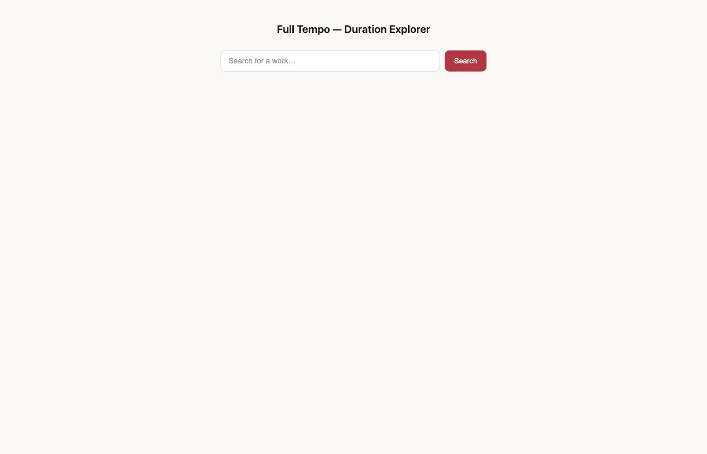
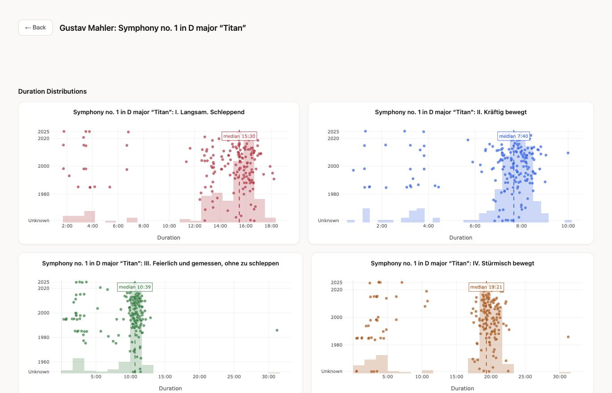
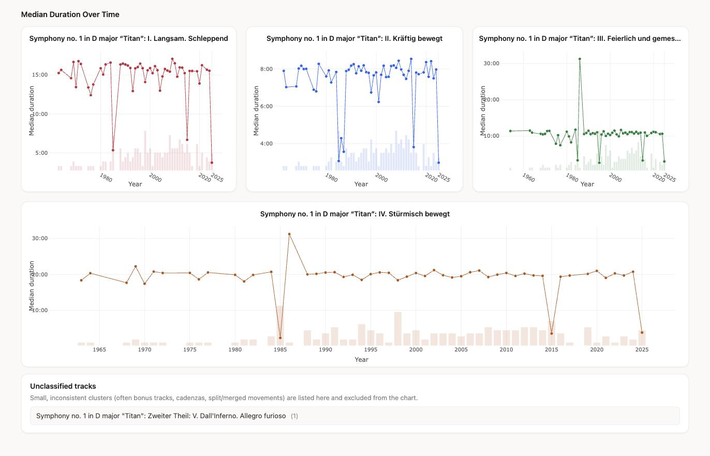

# Full Tempo

Search a classical work and see how its recorded duration has varied across
hundreds of performances — one interactive chart per movement, plus how the
median duration has drifted over the decades.

Live at **https://full-tempo-1065495173877.us-east1.run.app**

## Duration distributions

For each movement: every recording's duration as a point, positioned by
year, with a duration histogram behind it and a median line.

## Median duration over time

The same data, read the other way — one line per movement charting how the
median performance duration has shifted year to year, with a faint
recording-count histogram showing how much each year's median is actually
based on.

## How it works

Data comes from a trimmed, local copy of [MusicBrainz](https://musicbrainz.org)
(see [`data/README.md`](data/README.md) for what's in it and how it's
built) — recordings linked to a work via MusicBrainz's "performance"
relationship, with the work-to-work "parts" relationship giving each piece
its movement structure. A Flask backend serves the data; the frontend is a
single page using [Plotly](https://plotly.com/javascript/) for the charts.
